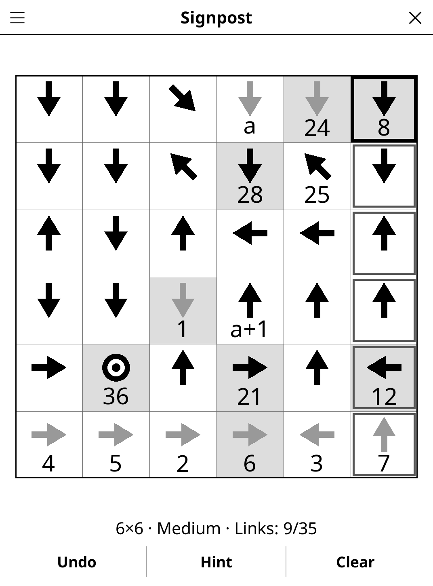

# signpost.koplugin

A Signpost puzzle for [KOReader](https://github.com/koreader/koreader),
after Simon Tatham's "Signpost".

## Screenshot

## Rules

Number every cell from 1 to the last number so that each number's successor
lies somewhere along its arrow, next to it or further away. The first and last
numbers are given (the last cell has a ring instead of an arrow), and sometimes
a few others, on a grey background.

## Features

- **Four grid sizes** — 4×4 to 7×7
- **Three difficulty levels**, measured by the solver:
  - *Easy* — every link follows from a cell having only one possible
    successor or predecessor;
  - *Medium* — also needs number bookkeeping: a chain cannot take numbers
    another chain already holds, nor be longer than any free gap;
  - *Hard* — also needs one-step "what if" trials.
- **Unique solution, always** — solved by deduction at generation, and
  counted exhaustively before it is shown.
- **Chain labels** like the original: chains holding a given number show
  their numbers, the others get letters (a, a+1, a+2…).
- **Large arrows** that turn grey once their cell has a successor, so the
  cells left to link stand out on e-ink.
- **Hint** — two taps: the first names a cell, the second draws its link (or
  cuts a wrong one first).
- **Undo**, **Clear**, **Show solution**, **timer**, **auto-save**.

## Controls

| Action | How |
|--------|-----|
| Select a cell | Tap it — the cells along its arrow get a light frame |
| Link the next cell | Tap one of the framed cells (it becomes the selection, so a chain is built by tapping its cells in order) |
| Undo that link | Tap the selected cell's successor again |
| Cut both links of a cell | Hold it |
| Undo / Clear | **Undo** / **Clear** |
| Size, difficulty, solution, rules | Title-bar menu |

A link that would close a loop, or join two given numbers at the wrong
distance, is refused.

## Generator

A random Hamiltonian path over queen moves (depth-first, Warnsdorff order)
gives the arrows. Numbers are added where the solver gets stuck, then removed
again while the grid stays solvable within the difficulty's tier; 1 and the
last number always stay. Worst case over 50 seeds at 7×7 Hard on a desktop:
about 0.45 s (LuaJIT).

## License

GPL-3.0 — see [LICENSE](LICENSE).
